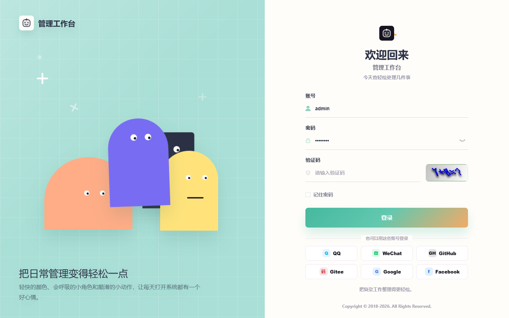
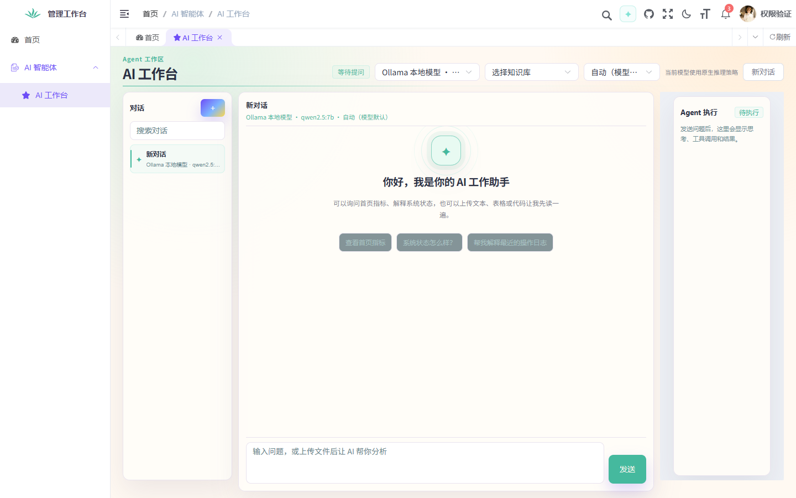

# 管理工作台

基于 RuoYi-Vue 演进的前后端分离系统框架。保留用户、角色、菜单、任务调度和代码生成等基础能力，更新明快的界面，并加入 AI 工作台、动态模型管理与可追踪的知识库问答。

项目代码标识为 `zzl`。适合用于管理系统开发、AI 应用集成和二次开发。

## 界面预览

### 登录页

薄荷绿与暖白底色，配合会互动的小角色；登录与注册共用品牌图标。



### AI 工作台

对话、模型选择、知识库选择和 Agent 执行过程集中在一个工作区。下图为仅授予聊天权限的账号，菜单和操作随角色权限变化。



## 已有功能

- **管理基础**：用户、角色、动态菜单、部门、字典、参数、日志、任务调度与代码生成。
- **工作台首页**：读取实际管理数据，支持 SSE 实时通知和 ECharts 服务资源趋势图。
- **AI 对话**：顶栏简聊与独立工作台，支持流式回答、停止生成、对话搜索、历史记录和刷新恢复。
- **模型管理**：按账号保存模型配置，获取服务端模型目录；默认只保留 Ollama，第三方模型自行添加。
- **Agent 与文件**：接入 LangChain4j，展示工具调用和执行事件，支持附件分析与来源预览。
- **知识库**：独立文件索引、多知识库选择、分块配置、混合检索、检索测试、索引任务追踪和回答引用。
- **菜单与权限**：AI 页面通过后台菜单生成动态路由，页面、按钮和接口沿用框架角色权限体系。

## 技术栈

以下版本以当前仓库配置为准。

| 层次 | 技术 |
| --- | --- |
| 后端 | Java 21、Spring Boot 4.0.6、Spring Security、MyBatis、Druid |
| 前端 | Vue 3.5.34、Vite 6.4.1、Element Plus 2.14.0 |
| 状态与路由 | Pinia 3.0.4、Vue Router 4.6.4 |
| 图表与实时通信 | ECharts 5.6.0、SSE |
| AI 集成 | LangChain4j 1.22.0、厂商适配器与模型能力协议 |
| 数据存储 | MySQL、Redis；Qdrant 可选 |
| 文件解析 | Apache POI 5.5.1、PDFBox 3.0.5 |

## 项目结构

```text
zzl
├── zzl-admin       后端入口、接口、AI 与知识库服务
├── zzl-framework   框架配置、认证和权限
├── zzl-system      系统管理业务
├── zzl-common      公共工具与基础类型
├── zzl-quartz      定时任务
├── zzl-generator   代码生成
├── zzl-ui          Vue 前端
├── sql             数据库初始化与 AI 表结构
├── doc             功能说明与界面预览
└── bin             Windows 构建和启动脚本
```

## 本地启动

### 1. 准备环境

- JDK 21。
- Maven 3.8+。
- Node.js 22+ 与 npm。
- MySQL 8 和 Redis，启动前完成连接配置。
- Ollama 或第三方模型服务按需接入，不是基础框架启动的必需条件。

### 2. 初始化数据库

创建与数据源配置一致的数据库，字符集使用 `utf8mb4`。**仅在新数据库中**依次导入：

1. [sql/zzl_20260417.sql](sql/zzl_20260417.sql)
2. [sql/quartz.sql](sql/quartz.sql)

基础脚本包含重建表语句。已有数据库升级时不要重新导入基础脚本。

AI 表结构由 `AiConversationSchemaInitializer` 在启动时准备；也提供 [AI 对话表](sql/zzl_ai_conversation.sql) 和 [Agent 表](sql/zzl_ai_agent_v6.sql) 供查看或手动初始化。启动账号需要具备相应建表、更新表结构权限。

### 3. 修改连接配置

| 文件 | 配置内容 |
| --- | --- |
| [application-druid.yml](zzl-admin/src/main/resources/application-druid.yml) | MySQL 地址、库名和账号 |
| [application.yml](zzl-admin/src/main/resources/application.yml) | Redis、文件目录、后端端口、AI 与 RAG 默认配置 |
| [zzl-ui/.env.development](zzl-ui/.env.development) | 前端标题与开发接口前缀 |
| [zzl-ui/vite.config.js](zzl-ui/vite.config.js) | 前端开发端口和后端代理地址 |

`zzl.profile` 是上传文件目录，默认 `D:/zzl/uploadPath`；更换环境时修改为本机可写目录。

### 4. 启动后端

在项目根目录执行：

```powershell
mvn -pl zzl-admin -am package -DskipTests
.\bin\run.bat
```

也可以直接运行构建后的可执行包：

```shell
java -jar zzl-admin/target/zzl-admin.jar
```

默认端口为 `8080`。重新打包同一个 JAR 前，先停止占用它的后端进程。

### 5. 启动前端

另开终端执行：

```shell
cd zzl-ui
npm install
npm run dev
```

浏览器访问 `http://localhost:8081`。开发接口前缀为 `/dev-api`，由 Vite 转发到 `http://localhost:8080`。

## 接入 AI 模型

进入左侧“AI 智能体 → 模型管理”，添加服务地址、API Key 和模型。可以先获取模型列表，再选择实际调用的模型名称；配置按当前登录账号保存到 MySQL。

| 厂商类型 | 适配方式 |
| --- | --- |
| OpenAI | OpenAI 接口及对应模型能力参数 |
| Anthropic / Claude | Anthropic 适配器 |
| DeepSeek | DeepSeek 适配器 |
| Ollama | 本地模型服务 |
| 其他服务 | 通用 OpenAI 兼容接口 |

厂商类型和模型能力协议决定请求参数。工作台根据能力配置展示推理选项，实际可用挡位由具体模型及服务接口决定；模型目录不保证提供完整的推理能力信息。

默认 Ollama 配置使用 `http://localhost:11434/v1` 和 `qwen2.5:7b`。使用该配置前，需要启动本地 Ollama 并准备对应模型，例如：

```shell
ollama pull qwen2.5:7b
```

未配置可用模型时，系统可返回本地管理数据摘要。该回退结果不代表已经调用真实 AI；Ollama 未启动时，选择该模型会出现连接错误。

## 知识库与检索

1. 在“知识库”中新建知识库并上传文件。
2. 根据需要设置分块大小、重叠长度、Top-K、相似度阈值和向量模型。
3. 在索引任务中查看排队、进度和失败原因，执行暂停、恢复或重试。
4. 使用“检索测试”检查召回片段、排序、得分和耗时。
5. 在 AI 工作台选择知识库提问，通过回答引用核对原文。

支持提取文本、Markdown、代码、CSV、PDF、DOCX、Excel 和 PPTX 等文件内容。切片使用关键词与向量双路召回，通过 RRF 合并名次，再执行可配置的规则重排。

聊天模型与 Embedding 模型分别配置。默认本地词法向量使用哈希特征，便于直接体验流程；需要语义检索时，配置 Ollama 或 OpenAI 兼容的 Embedding 服务。修改分块或向量模型后，需要重建索引。

Qdrant 默认关闭。启用后作为可选向量存储，访问失败时回退到 MySQL 中同一模型的向量；远程 Embedding 失败不会用另一种向量冒充成功结果。

图片可以作为附件上传，图片问答需要所选模型支持视觉输入。**默认不启用 OCR，也没有完成知识库图片内容理解流程**；图片、扫描版 PDF 不能保证直接形成可检索文本。

完整配置与行为说明见 [AI 知识库 V6.5 第二阶段](doc/AI知识库V6.5第二阶段.md)。

## 持久化与权限

| 数据 | 保存位置 |
| --- | --- |
| 对话、消息、模型配置、Agent 运行记录 | MySQL |
| 知识库配置、文件关系、切片、向量 JSON、索引任务 | MySQL |
| 上传的原始文件 | `zzl.profile/ai-files/` |
| 登录状态与运行缓存 | Redis |
| 可选外部向量索引 | Qdrant |

AI 数据不依赖 Redis 作为唯一持久化位置。迁移环境时，需要同时保留数据库和上传文件目录。

首次启动会自动导入 AI 目录、三个页面和操作权限。管理员在“系统管理 → 角色管理”中授权，普通角色不会自动获得 AI 功能。修改授权后，用户重新登录以刷新菜单和权限。

| 页面 | 页面权限 |
| --- | --- |
| AI 工作台 / 顶栏简聊 | `ai:workbench:query` |
| 模型管理 | `ai:model:list` |
| 知识库 | `ai:knowledge:list` |

发送消息、上传附件、模型维护和知识库索引等操作可独立授权。菜单由 `sys_menu` 和 `/getRouters` 动态加载；初次迁移完成后，重启不会覆盖菜单改名、排序或停用结果。详见 [AI 菜单与权限](doc/AI菜单与权限.md)。

## 构建与验证

后端打包使用前述 Maven 命令。前端生产构建：

```shell
cd zzl-ui
npm run build:prod
```

产物位于 `zzl-ui/dist`，生产接口前缀为 `/prod-api`。部署时将该前缀代理到后端；SSE 接口需要关闭代理响应缓冲，才能及时展示流式内容。

不依赖外部模型或数据库的 AI 权限、检索、任务控制和向量协议测试：

```powershell
mvn -pl zzl-admin -am test "-Dtest=AiPermissionTest,AiKnowledgeRetrievalTest,AiRagTaskControlTest,AiVectorProtocolTest" "-Dsurefire.failIfNoSpecifiedTests=false"
```

真实 MySQL 集成测试需要配置数据库并显式启用：

```powershell
$env:ZZL_AI_MYSQL_SMOKE = "true"
mvn -pl zzl-admin -am test "-Dtest=AiKnowledgeMysqlIntegrationTest,AiMenuMysqlIntegrationTest" "-Dsurefire.failIfNoSpecifiedTests=false"
Remove-Item Env:ZZL_AI_MYSQL_SMOKE
```

实际模型的连通性、视觉能力和推理参数，需使用自己的模型服务进一步验证。当前知识库重排为规则重排，尚未接入独立神经重排序模型或 LLM 查询改写。

## 开源说明

基于 RuoYi-Vue 二次开发，感谢原项目及相关开源依赖。项目遵循 [MIT License](LICENSE)。
